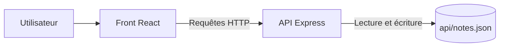

# Notes App

Groupe : Pottier Sylvain, Blondeau Ayrton, Huart Geoffroy, Adib Houssine et Soulet Kylian.

## Présentation

Notes App est une petite application pour créer, afficher et rechercher des notes. Le projet utilise React pour le site et Express pour l'API.

### Prérequis

- Node.js et npm
- Un navigateur web

## Installation et lancement

Ouvrir deux terminaux dans le dossier du projet.

Dans le premier terminal, lancer l'API :

```bash
cd api
npm install
npm start
```

L'API est disponible sur `http://localhost:3000`.

Dans le deuxième terminal, lancer le site :

```bash
cd web
npm install
npm run dev
```

Ouvrir l'adresse indiquée par Vite, généralement `http://localhost:5173`.

## Configuration

Aucune configuration supplémentaire n'est nécessaire. L'adresse de l'API et son port (`3000`) sont indiqués dans le code. Les notes sont enregistrées dans `api/notes.json`.

## Utilisation de l'API

Les exemples utilisent `curl.exe`, disponible dans PowerShell sous Windows.

### Créer une note

```bash
curl.exe -X POST http://localhost:3000/notes -H "Content-Type: application/json" -d "{\"title\":\"Ma note\",\"body\":\"Bonjour\",\"tag\":\"cours\"}"
```

Réponse (l'identifiant est généré par l'API) :

```json
{"id":1,"title":"Ma note","body":"Bonjour","tag":"cours"}
```

### Récupérer les notes

```bash
curl.exe "http://localhost:3000/notes?page=0"
```

Réponse possible :

```json
[{"id":1,"title":"Ma note","body":"Bonjour","tag":"cours"}]
```

La taille d'une page est de 10 notes. Dans le code actuel, `page=0` correspond à la première page.

### Récupérer les notes d'un tag

```bash
curl.exe http://localhost:3000/notes/by-tag/cours
```

Réponse possible :

```json
[{"id":1,"title":"Ma note","body":"Bonjour","tag":"cours"}]
```

### Rechercher dans les titres

```bash
curl.exe "http://localhost:3000/search?q=Ma"
```

Réponse possible :

```json
[{"id":1,"title":"Ma note","body":"Bonjour","tag":"cours"}]
```

### Supprimer une note

```bash
curl.exe -X DELETE http://localhost:3000/notes/1
```

Réponse : `204 No Content` (pas de contenu renvoyé).

## Capture du front

Une capture d'écran du site est à ajouter ici après avoir lancé le front et l'API.

## Architecture



## Contribution et licence

Pour contribuer, créer une branche, faire ses modifications, puis proposer une pull request.

Ce projet est réalisé dans un cadre pédagogique. Aucune licence n'est définie pour le moment.
